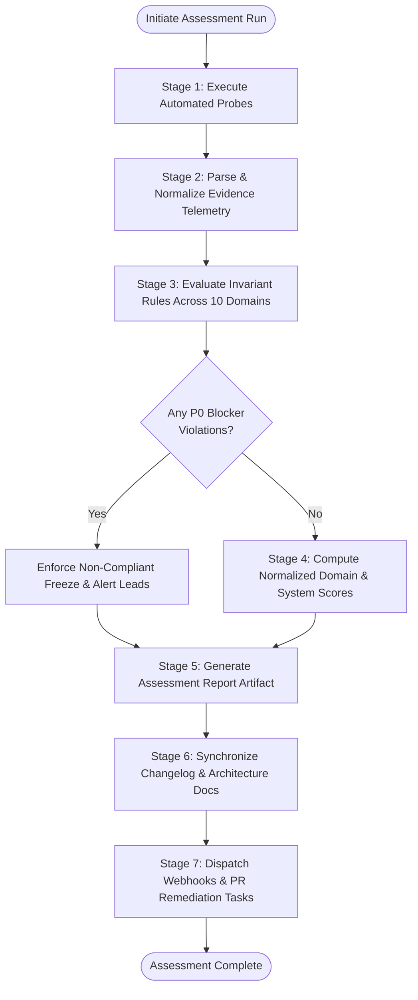

# Enterprise System Architecture Assessment Framework & Audit Standard

> **Document Version**: `1.0.0`  
> **Status**: Approved Standard  
> **Authoritative Scope**: Monorepos, Modular Monoliths, Microservices, and Cloud Infrastructure  
> **Target Deployments**: GitHub Enterprise Cloud (GHEC), GitHub Enterprise Server (GHES), Hybrid Containers, and Serverless

---

## 1. Executive Summary & Core Architectural Principles

This framework establishes the standard methodology for evaluating, auditing, and enhancing the architectural posture of software systems across their entire engineering lifecycle. Modern systems require continuous verification against eight foundational architectural pillars, extended by documentation hygiene and GitHub Enterprise governance:

```
+---------------------------------------------------------------------------------------------------------+
|                                10 ARCHITECTURAL ASSESSMENT DOMAINS                                      |
+--------------------+--------------------+--------------------+--------------------+--------------------+
| 01. Scalability    | 02. Resiliency     | 03. Efficiency     | 04. Simplicity     | 05. Documentation  |
| Throughput & Head  | Fault Tolerance    | Resource Waste     | Minimalist Design  | Up-to-date Specs   |
+--------------------+--------------------+--------------------+--------------------+--------------------+
| 06. Disaster Recov | 07. Modularity     | 08. Interoperable  | 09. Observability  | 10. GHE Governance |
| Zero Data Loss     | Loose Coupling     | Standard APIs      | Logs & Telemetry   | Cloud & Server     |
+--------------------+--------------------+--------------------+--------------------+--------------------+
```

### Core Design Principles

1. **Scalability by Design**: Growth must not cause exponential complexity or performance degradation. Both compute and storage scale horizontally with predictable cost models.
2. **Resilience & Fault Isolation**: Failures are inevitable; outages are not. Subsystems fail gracefully in degraded modes with zero cascading outages.
3. **Efficiency without Premature Optimization**: Resources (compute, memory, bandwidth, and human developer time) are protected against waste through automated pipelines and profiling.
4. **Radical Simplicity**: Systems are kept as simple as possible while fulfilling business and regulatory requirements. Cognitive load and accidental complexity are actively pruned.
5. **Continuous Verifiable Documentation**: Architecture specifications and operational runbooks are version-controlled alongside code and automatically kept in sync.
6. **Zero-Loss Disaster Recovery**: Recovery procedures are not theoretical hypotheses; they are systematically automated, encrypted, replicated, and tested in staging drills.
7. **High Cohesion & Low Coupling**: Service and codebase boundaries are enforced strictly through typed contracts, preventing monolithic entanglements.
8. **Open Standards & Interoperability**: Protocols, formats, and interfaces follow industry consensus, eliminating vendor lock-in and enabling ecosystem extensibility.
9. **Omnipresent Observability**: Systems emit structured telemetry (metrics, logs, traces) that empower engineers to diagnose anomalies within minutes.
10. **Zero-Trust Enterprise Governance**: Identity, least-privilege RBAC, branch protection, and supply-chain security are cryptographically enforced across all code and server environments.

---

## 2. Mathematical Scoring & Radar Evaluation Model

Every architectural evaluation computes a weighted composite score across all 10 domains:

$$\text{Architecture Score } (S_{\text{total}}) = \sum_{i=1}^{10} w_i \cdot S_i \quad \text{where} \quad \sum_{i=1}^{10} w_i = 1.0$$

Each individual domain score ($S_i$) is calculated from verified checklist items weighted by their priority:

$$S_i = \frac{\sum_{j=1}^{N_i} p_j \cdot v_j}{\sum_{j=1}^{N_i} p_j} \times 100$$

Where priority weights are:

- **$p_j = 4.0$** for `[P0]` (Critical / Blocker)
- **$p_j = 2.5$** for `[P1]` (High)
- **$p_j = 1.5$** for `[P2]` (Medium)
- **$p_j = 1.0$** for `[P3]` (Low)

And verification value $v_j \in \{1.0 \text{ ([PASSED])}, 0.5 \text{ ([WARNING])}, 0.0 \text{ ([FAILED])}\}$.

### Compliance Radar Tiers

| Tier Label        | Score Range      | Minimum Criteria                            | Production Gate Policy                                   |
| :---------------- | :--------------- | :------------------------------------------ | :------------------------------------------------------- |
| **Platinum**      | `95.0% - 100.0%` | 100% P0 and P1 pass; 0 open critical alerts | Unrestricted production deployment.                      |
| **Gold**          | `85.0% - 94.9%`  | 100% P0 pass; >= 90% P1 pass                | Standard production deployment approved.                 |
| **Silver**        | `70.0% - 84.9%`  | 100% P0 pass; P1 remediation ticketed       | Conditional staging release; 14-day fix SLA.             |
| **Bronze**        | `55.0% - 69.9%`  | P0 gaps present or multiple P1 failures     | Release blocked; architecture review required.           |
| **Non-Compliant** | `< 55.0%`        | Critical architectural failure              | **Immediate deployment freeze**; emergency remediations. |

---

## 3. Master MVP Architecture & System Flow

### System Component Architecture

```
+--------------------------------------------------------------------------------------------------------+
|                                    ASSESSMENT ENGINE ARCHITECTURE                                      |
+--------------------------------------------------------------------------------------------------------+
                                                    |
                         +--------------------------+--------------------------+
                         |                                                     |
                         v                                                     v
+--------------------------------------------------+ +--------------------------------------------------+
|            DATA & PROBE COLLECTORS               | |                EVALUATION ENGINE                 |
+--------------------------------------------------+ +--------------------------------------------------+
| * Git & Repo Analyzer: branches, rules, properties| | * Invariant Rule Checker: validates 10 domains   |
| * AST Code Scanner: imports, coupling, modularity | | * Scoring Synthesizer: weighted radar matrix     |
| * Infra Health Probes: load balancer, pods, DB   | | * Risk & Gap Classifier: P0-P3 categorization    |
| * Log & Telemetry Probes: latency, error rate    | | * Audit Attestation: cryptographically verified  |
+--------------------------------------------------+ +--------------------------------------------------+
                         |                                                     |
                         +--------------------------+--------------------------+
                                                    |
                                                    v
+--------------------------------------------------------------------------------------------------------+
|                                  PRESENTATION & REMEDIATION LAYER                                      |
+--------------------------------------------------+---------------------------------------------------+
| * REST API: /api/v1/architecture-assessment/*    | * Automated Remediation: PR generation & alerts   |
| * Interactive Radar Dashboard: web UI scorecards  | * Real-time Documentation: sync to /document & md |
+--------------------------------------------------+---------------------------------------------------+
```

### Assessment Execution Lifecycle



---

## 4. REST API Specification (7-Layer Modular Monolith)

The assessment framework is exposed via standard REST endpoints adhering to the modular monolith pattern.

### 4.1 Endpoints Overview

```
POST   /api/v1/architecture-assessment/evaluations          # Trigger evaluation
GET    /api/v1/architecture-assessment/evaluations          # List evaluations
GET    /api/v1/architecture-assessment/evaluations/:id      # Get full report
GET    /api/v1/architecture-assessment/evaluations/:id/domains/:domainKey # Domain detail
PATCH  /api/v1/architecture-assessment/evaluations/:id/items/:checkId    # Attest item
POST   /api/v1/architecture-assessment/evaluations/:id/remediate         # Trigger auto-remediation
GET    /api/v1/architecture-assessment/evaluations/:id/export            # Export report
GET    /api/v1/architecture-assessment/metrics/radar                     # Aggregate radar metrics
```

### 4.2 Sample Request & Response Payloads

#### Trigger Evaluation (`POST /api/v1/architecture-assessment/evaluations`)

```json
{
  "targetName": "SNP-SMS-Monorepo",
  "targetType": "MONOREPO",
  "domains": [
    "SCALABILITY",
    "RESILIENCY",
    "EFFICIENCY",
    "SIMPLICITY",
    "DOCUMENTATION",
    "DISASTER_RECOVERY",
    "MODULARITY",
    "INTEROPERABILITY",
    "OBSERVABILITY",
    "GITHUB_ENTERPRISE"
  ],
  "includeGitHubEnterprise": true,
  "options": {
    "dryRun": false,
    "autoRemediate": false
  }
}
```

#### Evaluation Report Response (`200 OK`)

```json
{
  "id": "c7a8e291-61b4-4e2a-9f5b-1172a80198de",
  "targetName": "SNP-SMS-Monorepo",
  "createdAt": "2026-11-03T12:00:00.000Z",
  "completedAt": "2026-11-03T12:00:45.000Z",
  "status": "COMPLETED",
  "overallScore": 92.4,
  "tier": "GOLD",
  "domainScores": {
    "SCALABILITY": 94.0,
    "RESILIENCY": 96.5,
    "EFFICIENCY": 88.0,
    "SIMPLICITY": 95.0,
    "DOCUMENTATION": 91.5,
    "DISASTER_RECOVERY": 98.0,
    "MODULARITY": 93.0,
    "INTEROPERABILITY": 90.0,
    "OBSERVABILITY": 89.0,
    "GITHUB_ENTERPRISE": 91.0
  },
  "p0ViolationsCount": 0,
  "p1ViolationsCount": 2,
  "itemsSummary": {
    "total": 65,
    "passed": 58,
    "warning": 5,
    "failed": 2
  }
}
```

---

## 5. Autonomous AI Agent Audit Protocol

Autonomous AI Agents auditing a repository or cloud infrastructure must follow this exact execution cycle:

1. **Discovery & Topology Mapping**:
   - Inspect workspace configuration (`package.json`, `pnpm-workspace.yaml`, or microservice boundaries).
   - Identify runtime manifests (Dockerfiles, Kubernetes YAMLs, Terraform files, CI/CD workflows).
2. **Telemetry & Evidence Gathering**:
   - Probe git branch protection rules, custom properties, and commit histories.
   - Verify automated test suites, smoke test scripts, and typecheck scripts.
   - Inspect database configurations (e.g. MongoDB replica set `rs0` or PostgreSQL replication).
3. **Invariant Rule Verification**:
   - Test each checklist item across all 10 domains against verified machine evidence.
   - Never hallucinate passing checks or assume unverified infrastructure states.
4. **Scoring & Risk Grading**:
   - Compute normalized domain scores ($S_i$) and overall total score ($S_{\text{total}}$).
   - Flag any `[P0]` violation as an immediate pipeline blocker.
5. **Remediation Plan Formulation**:
   - Produce structured action tables with exact remediation paths, configuration diffs, and SLAs.
6. **Real-time Documentation Sync**:
   - Execute `npm run changelog:sync` and record architectural changes in `CHANGELOG.md`.

---

## 6. Priority Matrix Definition

| Priority Code | Severity               | Description                                                                                                   | Max Resolution SLA      | CI/CD Quality Gate Action                            |
| :------------ | :--------------------- | :------------------------------------------------------------------------------------------------------------ | :---------------------- | :--------------------------------------------------- |
| **`[P0]`**    | **Critical / Blocker** | Direct risk of data loss, zero backup verification, exposed credentials, broken SSO, single point of failure. | **Immediate** (Blocker) | **Fails build immediately**. Deployment prohibited.  |
| **`[P1]`**    | **High**               | Absence of HA failover, lack of branch protection, unmonitored replication lag, unversioned API.              | **7 Calendar Days**     | Generates CI warning; blocks production release tag. |
| **`[P2]`**    | **Medium**             | Missing APM profiler, suboptimal cache TTLs, absence of service discovery, lack of ADR documentation.         | **30 Calendar Days**    | Tracked in architecture backlog.                     |
| **`[P3]`**    | **Low**                | Non-standard naming conventions, minor log format variance, documentation styling enhancements.               | **Scheduled Sprint**    | Continual improvement backlog.                       |

---

## 7. The Complete 10-Domain Architecture Assessment Checklist

### 7.1 Domain 1: Scalability (`DOM-01`)

- **Objective**: Ensure the system handles sustained growth, peak traffic bursts, and expanding codebase size without architectural friction or performance collapse.

| Check ID | Architectural Criterion & Audit Question                                                                       | Verification Target                 | Priority | Acceptance Standard                                                                         |
| :------- | :------------------------------------------------------------------------------------------------------------- | :---------------------------------- | :------- | :------------------------------------------------------------------------------------------ |
| `SCA-01` | **Repository Structure & Clarity**: Is repository organized for clarity and growth?                            | Directory layout, workspace configs | `[P1]`   | Segmented into logical monorepo workspaces or isolated repos; clear root README.            |
| `SCA-02` | **Naming Conventions & Descriptions**: Do repositories follow clear conventions with descriptions?             | Repository metadata, GitHub API     | `[P3]`   | Standardized naming (`[scope]-[domain]-[role]`); non-empty description on all repositories. |
| `SCA-03` | **Custom Properties Governance**: Are custom properties used to manage and enforce repository rules?           | GitHub Organization properties      | `[P2]`   | Properties set for compliance tier, security classification, and owning team.               |
| `SCA-04` | **Segmentation & Anti-Monolith Boundary**: Are repositories appropriately segmented to avoid monolithic traps? | Package dependency graph            | `[P1]`   | Distinct separation between shared contracts, frontend app, and backend monolith/services.  |
| `SCA-05` | **Branch Protection Enforcement**: Are branch protection rules active to safeguard code quality?               | GitHub Ruleset API                  | `[P0]`   | Direct pushes disabled on `main`; mandatory `>= 1` review; required passing CI checks.      |
| `SCA-06` | **Code Modularity & Loose Coupling**: Are code modules reusable, encapsulated, and loosely coupled?            | AST import graph                    | `[P1]`   | Modules export strictly defined public APIs; zero circular dependencies across packages.    |
| `SCA-07` | **Modularity Design Patterns**: Does code leverage design patterns promoting modularity?                       | Backend/Frontend architecture       | `[P2]`   | Adoption of 7-layer architecture, dependency injection, and clean hexagonal boundaries.     |
| `SCA-08` | **Documented Module Dependencies**: Are inter-module dependencies comprehensively documented?                  | `boundary-rules.md`, ADRs           | `[P2]`   | Clear dependency flow diagrams; explicit rules forbidding unauthorized cross-layer imports. |
| `SCA-09` | **Tech Stack Consistency**: Is the technology stack standardized across projects?                              | `package.json`, runtime specs       | `[P1]`   | Standardized language (TypeScript), framework conventions, and testing tools.               |
| `SCA-10` | **Tech Stack Ecosystem & Support**: Are selected technologies well-supported with active communities?          | Dependency audits, LTS status       | `[P2]`   | Supported active LTS runtimes; clean `npm audit` reports; no abandoned dependencies.        |
| `SCA-11` | **Dependency Version Locking**: Is version control used to manage dependencies strictly?                       | Root `package-lock.json`            | `[P1]`   | Single unified lockfile; automated vulnerability alerts enabled via Dependabot.             |
| `SCA-12` | **On-Demand Ephemeral Resource Recreation**: Can ephemeral resources be spun up on demand?                     | Docker Compose, IaC templates       | `[P1]`   | Development and staging environments spin up from scratch with a single command.            |
| `SCA-13` | **Compute Headroom & Capacity Planning**: Do non-ephemeral resources maintain headroom for growth?             | Cloud / Host metrics                | `[P1]`   | Steady-state CPU and memory usage remain `< 70%`, preserving `>= 30%` burst capacity.       |
| `SCA-14` | **Load Balancer Implementation**: Is traffic distributed via a robust load balancer?                           | Ingress / Proxy manifests           | `[P0]`   | Reverse proxy or cloud load balancer distributes requests with active health check probes.  |
| `SCA-15` | **Performance Under Load**: Does the system withstand 2x peak traffic without degradation?                     | Load test benchmarks                | `[P1]`   | Latency p95 remains `< 300ms`; error rate remains `< 0.01%` during stress testing.          |
| `SCA-16` | **Scalable Storage Architecture**: Are storage solutions capable of elastic horizontal expansion?              | Database / Object store             | `[P1]`   | Database scales via sharding/replicas; file assets stored in elastic object storage.        |

---

### 7.2 Domain 2: Resiliency (`DOM-02`)

- **Objective**: Build fault-tolerant systems that absorb infrastructure shocks, prevent cascading collapses, and maintain continuous operations.

| Check ID | Architectural Criterion & Audit Question                                                   | Verification Target          | Priority | Acceptance Standard                                                                         |
| :------- | :----------------------------------------------------------------------------------------- | :--------------------------- | :------- | :------------------------------------------------------------------------------------------ |
| `RES-01` | **Fault Tolerance & Graceful Degradation**: Can the system operate during partial failure? | Circuit breakers, fallbacks  | `[P0]`   | Secondary dependency failures do not block primary customer transactions.                   |
| `RES-02` | **Configuration Drift Elimination**: Is environment drift minimized or eliminated?         | IaC & Docker manifests       | `[P1]`   | Staging and Production configurations generated deterministically from single source.       |
| `RES-03` | **Automated Backup Solutions**: Are automated backup solutions actively protecting state?  | Backup cron schedules, WAL   | `[P0]`   | Automated daily snapshots plus continuous write-ahead log (WAL/oplog) streaming.            |
| `RES-04` | **Secure Backup Storage**: Are backups stored securely and isolated from production?       | KMS keys, storage IAM        | `[P0]`   | Backups encrypted with customer-managed keys (AES-256); access strictly restricted.         |
| `RES-05` | **Rapid Restore Procedures**: Can backups be restored rapidly to satisfy RTO/RPO targets?  | Restore runbooks & tests     | `[P0]`   | Documented and verified restore procedures restoring service within `< 60 min` RTO.         |
| `RES-06` | **Regular Restore Drills to Staging**: Are restore procedures regularly tested in staging? | Staging drill execution logs | `[P1]`   | Monthly automated restore drills to staging; validates data integrity and test features.    |
| `RES-07` | **High Availability (HA) Topology**: Are high availability configurations implemented?     | Multi-node cluster topology  | `[P0]`   | Redundant nodes across multiple Availability Zones; zero single points of failure.          |
| `RES-08` | **Automated Failover Mechanisms**: Are failover mechanisms in place and verified?          | Failover test telemetry      | `[P0]`   | Automated failover executes within `< 10s` upon primary node failure without human action.  |
| `RES-09` | **Critical Component Redundancy**: Do all critical path components have active redundancy? | System topology diagrams     | `[P0]`   | Redundant instances for web servers, API gateways, database primaries, and message brokers. |

---

### 7.3 Domain 3: Efficiency (`DOM-03`)

- **Objective**: Maximize throughput and system effectiveness while minimizing resource waste, operational friction, and financial costs.

| Check ID | Architectural Criterion & Audit Question                                               | Verification Target         | Priority | Acceptance Standard                                                                       |
| :------- | :------------------------------------------------------------------------------------- | :-------------------------- | :------- | :---------------------------------------------------------------------------------------- |
| `EFF-01` | **Continuous Performance Monitoring**: Is system performance monitored continuously?   | APM metrics, Web Vitals     | `[P1]`   | Real-time monitoring of p50, p95, p99 latencies, database query times, and frontend CWV.  |
| `EFF-02` | **Resource Waste Avoidance**: Are computing resources used efficiently to avoid waste? | Utilization telemetry       | `[P2]`   | Idle infrastructure, unattached storage volumes, and orphan container images pruned.      |
| `EFF-03` | **Repetitive Task Automation**: Are repetitive engineering tasks fully automated?      | CI/CD scripts, build tools  | `[P1]`   | Format, lint, typecheck, test, smoke, build, and deploy automated with zero manual steps. |
| `EFF-04` | **Performance Profiling Tooling**: Are profiling tools used to identify bottlenecks?   | Flamegraphs, DB query plans | `[P2]`   | Profilers enabled in development/staging; slow query logger captures queries `> 100ms`.   |
| `EFF-05` | **Optimized Resource Allocation**: Is compute and memory allocation fine-tuned?        | Container CPU/RAM limits    | `[P1]`   | Explicit resource requests and limits defined for all containerized processes.            |
| `EFF-06` | **Resource Management Tooling**: Are resource management tools utilized effectively?   | Autoscalers, orchestrators  | `[P2]`   | Horizontal pod autoscaling (HPA) or serverless concurrency throttles configured.          |
| `EFF-07` | **Documented Automation Scripts**: Are all automation scripts well-documented?         | `scripts/` directory        | `[P2]`   | Every automation script contains standard CLI documentation and usage examples.           |
| `EFF-08` | **Automation Tools Maintenance**: Are automation tools and runners kept updated?       | Tool version manifests      | `[P2]`   | GitHub Actions, container bases, and build tools updated to latest stable versions.       |

---

### 7.4 Domain 4: Simplicity (`DOM-04`)

- **Objective**: Strip away non-essential abstractions, reduce cognitive load, and design straightforward topologies that are easy to reason about and maintain.

| Check ID | Architectural Criterion & Audit Question                                                    | Verification Target            | Priority | Acceptance Standard                                                                           |
| :------- | :------------------------------------------------------------------------------------------ | :----------------------------- | :------- | :-------------------------------------------------------------------------------------------- |
| `SIM-01` | **Minimalist Architecture Design**: Is the system designed as simply as possible?           | Architectural diagrams         | `[P1]`   | Prefers modular monolith over distributed microservices until scale strictly necessitates it. |
| `SIM-02` | **Straightforward System Topology**: Is the architecture easy to comprehend and explain?    | Network & dataflow maps        | `[P1]`   | Direct, traceable communication paths; zero unnecessary message queues or intermediaries.     |
| `SIM-03` | **Manageable Configuration Schemas**: Are system configurations straightforward to manage?  | `.env.example`, config modules | `[P1]`   | All environment variables validated with centralized Zod schemas; zero hidden flags.          |
| `SIM-04` | **Simplicity-Promoting Design Patterns**: Are simple, well-understood design patterns used? | Codebase design patterns       | `[P2]`   | Usage of standard MVC / 7-layer patterns; avoidance of deeply nested meta-programming.        |

---

### 7.5 Domain 5: Documentation (`DOM-05`)

- **Objective**: Maintain up-to-date, clear, and comprehensive documentation that serves as the single source of truth for engineering teams and autonomous agents.

| Check ID | Architectural Criterion & Audit Question                                                          | Verification Target           | Priority | Acceptance Standard                                                                           |
| :------- | :------------------------------------------------------------------------------------------------ | :---------------------------- | :------- | :-------------------------------------------------------------------------------------------- |
| `DOC-01` | **Clear & Concise System Documentation**: Are all systems and processes documented clearly?       | `docs/`, `AGENTS.md`, READMEs | `[P1]`   | High-quality documentation covering monorepo structure, security rules, and APIs.             |
| `DOC-02` | **Up-to-Date Documentation Lifecycle**: Is documentation actively updated alongside code changes? | Changelog sync mechanisms     | `[P1]`   | Automated real-time changelog sync (`npm run changelog:sync`) on every architectural release. |
| `DOC-03` | **Examples and Practical Use Cases**: Does documentation include concrete examples?               | API references, guides        | `[P2]`   | Every REST endpoint and architectural pattern includes concrete payload samples.              |
| `DOC-04` | **Documentation Management Tools**: Are modern tools used to manage and publish documentation?    | Live portal (`/document`)     | `[P2]`   | Interactive technical documentation portal deployed and accessible to engineers.              |

---

### 7.6 Domain 6: Disaster Recovery (`DOM-06`)

- **Objective**: Guarantee zero data loss, rapid recovery from catastrophic failures, and immediate rollback/restoration capabilities.

| Check ID | Architectural Criterion & Audit Question                                                            | Verification Target         | Priority | Acceptance Standard                                                                             |
| :------- | :-------------------------------------------------------------------------------------------------- | :-------------------------- | :------- | :---------------------------------------------------------------------------------------------- |
| `REC-01` | **Disaster Recovery Plan (DRP)**: Is a comprehensive DRP maintained and reviewed?                   | DRP runbook document        | `[P0]`   | Formal DRP with documented recovery targets (RTO `< 60 min`, RPO `< 15 min`).                   |
| `REC-02` | **Regular Disaster Recovery Drills**: Are DR procedures tested under simulated disaster conditions? | DR drill post-mortems       | `[P0]`   | Semi-annual simulated failover and disaster drills executed by engineering.                     |
| `REC-03` | **Data Replication Strategy**: Are data replication strategies implemented across regions?          | Database replication status | `[P0]`   | Asynchronous or synchronous replication to secondary data center/region active.                 |
| `REC-04` | **Defined Roles & Responsibilities**: Are incident management roles clearly assigned?               | Incident response matrix    | `[P1]`   | Incident Commander, Ops Lead, and Communications Lead designated with on-call roster.           |
| `REC-05` | **Git Force-Push Recovery Protocol**: Can repositories be recovered if accidentally force-pushed?   | Git reflog / mirror backups | `[P0]`   | Branch protection forbids unprivileged force pushes; remote reflogs or daily mirrors preserved. |
| `REC-06` | **Documented Test Review & Resolution**: Are DR drill results reviewed and issues remediated?       | Post-mortem issue tracker   | `[P1]`   | Any failure observed during drills produces high-priority remediation tickets.                  |
| `REC-07` | **Monitored Replication & Consistency**: Is replication health continuously monitored?              | Replication lag telemetry   | `[P0]`   | Real-time alerts fire if database replication lag exceeds 60 seconds.                           |

---

### 7.7 Domain 7: Modularity (`DOM-07`)

- **Objective**: Decouple business domains into independent, cohesive modules that allow rapid feature iteration without cascading regressions.

| Check ID | Architectural Criterion & Audit Question                                                              | Verification Target         | Priority | Acceptance Standard                                                                           |
| :------- | :---------------------------------------------------------------------------------------------------- | :-------------------------- | :------- | :-------------------------------------------------------------------------------------------- |
| `MOD-01` | **Service Separation & Independence**: Can services be developed, deployed, and scaled independently? | Monorepo package topology   | `[P1]`   | Frontend serverless deploys decoupled from backend long-running container deploys.            |
| `MOD-02` | **Clear & Well-Defined Interfaces**: Do modules expose strictly typed, documented interfaces?         | `@snp/shared` contracts     | `[P1]`   | Contracts, DTOs, and validation schemas exported exclusively from shared packages.            |
| `MOD-03` | **Codebase Modularity & Reusability**: Are codebase modules reusable and loosely coupled?             | Module source structure     | `[P1]`   | High cohesion within domain modules; zero shared internal state or cross-module leaks.        |
| `MOD-04` | **Design Patterns for Modularity**: Are design patterns that promote modularity utilized?             | Backend module layout       | `[P2]`   | Consistent 7-layer architecture across all 47 domain modules in the backend.                  |
| `MOD-05` | **Appropriate Microservices Usage**: Is microservices architecture used only where appropriate?       | Architectural ADRs          | `[P1]`   | Single modular monolith chosen over fragmented microservices; prevents network overhead.      |
| `MOD-06` | **Independent Deployability**: Can individual services deploy without synchronized lockstep?          | CI/CD deployment jobs       | `[P1]`   | Backend container builds and frontend web builds have separate, decoupled CI pipelines.       |
| `MOD-07` | **Effective Inter-Service Communication**: Do services communicate efficiently without blocking?      | Network protocol specs      | `[P1]`   | Standardized REST / JSON communication with strict timeouts and error envelopes.              |
| `MOD-08` | **Service Discovery Mechanisms**: Are dynamic service discovery mechanisms in place?                  | DNS / Ingress configuration | `[P2]`   | Internal container DNS (e.g. Docker bridge or Kubernetes CoreDNS) routes traffic dynamically. |

---

### 7.8 Domain 8: Interoperability (`DOM-08`)

- **Objective**: Facilitate seamless integration across heterogenous systems, platforms, environments, and vendor boundaries.

| Check ID | Architectural Criterion & Audit Question                                                              | Verification Target      | Priority | Acceptance Standard                                                                          |
| :------- | :---------------------------------------------------------------------------------------------------- | :----------------------- | :------- | :------------------------------------------------------------------------------------------- |
| `INT-01` | **Standardized API Integration**: Are APIs well-documented and easily integrated?                     | OpenAPI / REST contracts | `[P1]`   | Comprehensive REST documentation with standard HTTP status codes and error formats.          |
| `INT-02` | **API Versioning & Backward Compatibility**: Are APIs versioned to maintain backward compatibility?   | Route URL namespaces     | `[P1]`   | All public routes versioned (`/api/v1/*`); non-breaking deprecation schedules enforced.      |
| `INT-03` | **API Gateway Management & Security**: Is an API gateway used to manage and secure APIs?              | Gateway / Reverse proxy  | `[P1]`   | Centralized edge proxy manages rate limiting, CORS headers, and auth token validation.       |
| `INT-04` | **Industry Standards Compliance**: Does the architecture comply with industry technical standards?    | RFC specifications       | `[P1]`   | Strict compliance with HTTP/1.1, HTTP/2, TLS 1.3, JSON Schema, and OAuth 2.0 / JWT.          |
| `INT-05` | **Open-Source License Obligations**: Are open-source license obligations strictly fulfilled?          | Dependency license audit | `[P1]`   | Automated license audits confirm all packages use permissive licenses (MIT, Apache 2.0).     |
| `INT-06` | **Cross-Platform Compatibility**: Are systems verified to run across multiple environments?           | CI build matrices        | `[P1]`   | Application builds, runs, and tests reliably on macOS, Linux (Ubuntu), and Docker.           |
| `INT-07` | **Standardized Data Formats**: Are data formats standardized across all internal/external interfaces? | Serialization formats    | `[P2]`   | UTC timestamps (ISO 8601), UTF-8 text, decimal financial representations, and standard JSON. |

---

### 7.9 Domain 9: Observability (`DOM-09`)

- **Objective**: Provide deep, actionable insight into system health, performance, and internal state through ubiquitous telemetry.

| Check ID | Architectural Criterion & Audit Question                                                        | Verification Target        | Priority | Acceptance Standard                                                                                  |
| :------- | :---------------------------------------------------------------------------------------------- | :------------------------- | :------- | :--------------------------------------------------------------------------------------------------- |
| `OBS-01` | **Comprehensive Structured Logging**: Are logs structured to track system behavior and issues?  | Logger configuration       | `[P0]`   | JSON-formatted logs containing timestamp, level, traceId, schoolId, module, and message.             |
| `OBS-02` | **Secure Log Storage & Sanitization**: Are logs stored securely with sensitive data redacted?   | Log pipeline & sanitizers  | `[P0]`   | Automated sanitization masks passwords, authentication tokens, and personally identifiable info.     |
| `OBS-03` | **Enforced Log Retention Policies**: Are clear log retention and archival policies in place?    | Storage lifecycle policies | `[P1]`   | Hot log index retention set to 30 days; cold compliant archival storage set to 365 days.             |
| `OBS-04` | **Performance & Health Dashboards**: Are real-time monitoring dashboards actively reviewed?     | Monitoring dashboards      | `[P1]`   | Dashboards visualising RPS throughput, error rates (4xx/5xx), latency percentiles, and host CPU/RAM. |
| `OBS-05` | **Actionable Real-Time Alerting**: Do alerts notify engineering teams immediately with context? | Alert routing rules        | `[P0]`   | Alerts include affected system, severity badge, runbook link, and recent error traces.               |
| `OBS-06` | **Calibrated Thresholds & Anti-Fatigue**: Are thresholds configured to prevent alert fatigue?   | Alert configuration        | `[P1]`   | Alert thresholds use rate-of-change and anomaly detection; flapping alerts silenced.                 |
| `OBS-07` | **Anomaly Detection Capabilities**: Does monitoring support automated anomaly detection?        | APM anomaly detector       | `[P2]`   | Dynamic baselines detect abnormal spikes in error rates or latency without static limits.            |

---

### 7.10 Domain 10: GitHub Enterprise Deployments (`DOM-10`)

#### Sub-Domain 10A: GitHub Enterprise Cloud (GHEC)

- **Objective**: Secure enterprise cloud repositories, enforce strict organizational RBAC, protect supply chains, and meet regulatory data residency requirements.

| Check ID | Architectural Criterion & Audit Question                                                        | Verification Target         | Priority | Acceptance Standard                                                                                     |
| :------- | :---------------------------------------------------------------------------------------------- | :-------------------------- | :------- | :------------------------------------------------------------------------------------------------------ |
| `GEC-01` | **Enterprise RBAC & SSO Enforcement**: Is user access managed via SSO and strict RBAC?          | SAML SSO / Org settings     | `[P0]`   | Mandatory SAML SSO; role assignments mapped directly from corporate identity provider.                  |
| `GEC-02` | **Periodic User Permission Audits**: Are user permissions regularly audited and pruned?         | Access audit reports        | `[P1]`   | Quarterly audit of owners, maintainers, and outside collaborators; inactive accounts purged.            |
| `GEC-03` | **Security Compliance & Policies**: Do security policies comply with regulatory standards?      | Org security configurations | `[P0]`   | Secret scanning, push protection, private vulnerability reporting, and 2FA globally enforced.           |
| `GEC-04` | **Custom Integrations Security**: Are custom GitHub Apps and webhooks secured and maintained?   | Installed GitHub Apps       | `[P1]`   | Integrations use granular, least-privilege permissions; webhook secrets cryptographically verified.     |
| `GEC-05` | **Data Residency Compliance**: Does repository data residency comply with regional regulations? | GHEC tenant data residency  | `[P1]`   | Repositories, git LFS objects, and GitHub Actions artifacts localized to designated geographic regions. |

#### Sub-Domain 10B: GitHub Enterprise Server (GHES)

- **Objective**: Maintain, scale, protect, and back up self-hosted, on-premises GitHub Enterprise Server installations.

| Check ID | Architectural Criterion & Audit Question                                                       | Verification Target           | Priority | Acceptance Standard                                                                                       |
| :------- | :--------------------------------------------------------------------------------------------- | :---------------------------- | :------- | :-------------------------------------------------------------------------------------------------------- |
| `GES-01` | **User Management & Directory Sync**: Is GHES user management tied to enterprise directory?    | LDAP / SAML configuration     | `[P0]`   | Automated directory synchronization via LDAP or SAML SCIM; automatic account deprovisioning.              |
| `GES-02` | **On-Premises Security Compliance**: Are server security measures enforced and audited?        | Management Console audit logs | `[P0]`   | Strict SSH key policies, TLS 1.3 enforced, disabled weak ciphers, and audited administrative access.      |
| `GES-03` | **Custom Integrations Vetting**: Are custom GHES integrations vetted and monitored?            | Webhook and OAuth audit       | `[P1]`   | Webhooks restricted to internal subnets; outgoing traffic monitored for egress anomalies.                 |
| `GES-04` | **Network Configuration & Firewalls**: Is GHES isolated behind optimized, monitored firewalls? | Network firewall rules        | `[P0]`   | Host isolated inside protected VPC subnet; ingress restricted to VPN / office IPs; egress filtered.       |
| `GES-05` | **Scheduled Maintenance & Patching**: Are updates and security patches applied regularly?      | Patching records & schedule   | `[P1]`   | Monthly maintenance windows scheduled and communicated; zero-day security patches applied within 48h.     |
| `GES-06` | **Hardware Scalability & Capacity**: Is hardware capacity planned for future user/repo growth? | Storage & VM telemetry        | `[P1]`   | IOPS, RAM, and disk utilization monitored; alerts triggered when disk capacity exceeds 75%.               |
| `GES-07` | **Dedicated On-Premises Backup**: Are robust backup solutions implemented and verified?        | `ghe-backup` utility logs     | `[P0]`   | GitHub Enterprise Backup Utilities (`ghe-backup`) runs hourly/daily snapshots to an isolated backup host. |

---

## 8. Long-Term Architectural Research & Evolution Guide

For future development and ongoing project enhancements, teams should incorporate these principles into their architectural review boards:

1. **Continuous Architecture Audits as Code**:
   Integrate this framework directly into CI pipelines (`npm run architecture:audit`) so every pull request evaluates architectural invariants automatically.
2. **Dynamic Dependency Graphing**:
   Periodically generate visual dependency diagrams (`pnpm graph` or custom AST parsers) to catch budding circular dependencies before they harden.
3. **Automated Drift Detection**:
   Continuously reconcile container configurations and database indexes against code models, reporting drift via automated GitHub issues.
4. **Resilience Chaos Engineering**:
   Schedule non-disruptive chaos experiments in staging (e.g. killing a MongoDB replica node or restarting a container) to continuously validate failover.
5. **Living Architecture Alignment**:
   Always execute `npm run changelog:sync` whenever architectural boundaries, skills, or data contracts are adjusted, maintaining flawless real-time alignment between implementation and documentation.
