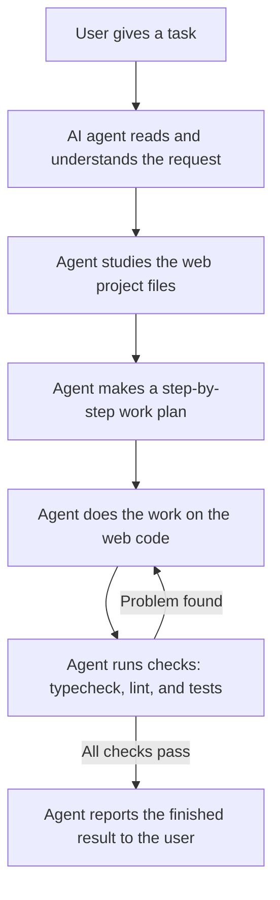

# SNPI-Web

SNPI-Web is the web portal for the SNPI School Management System, built with Next.js and React. It is the browser interface that staff, teachers, and administrators use to manage students, academics, attendance, examinations, and finance, working together with SNPI-API.

## How the AI Agent Works on This Project

